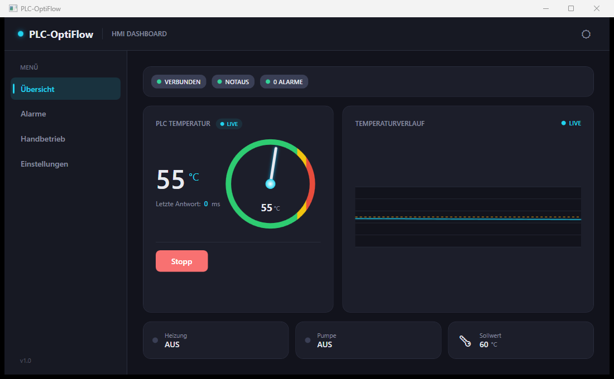
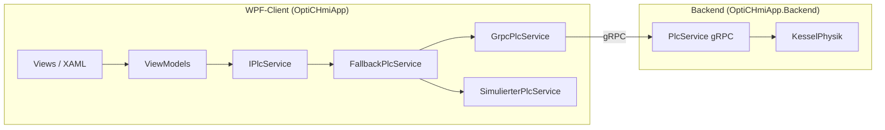

# PLC-OptiFlow

**WPF-HMI für eine simulierte Kesselanlage** · **WPF HMI for a simulated boiler** · **Simüle edilmiş kazan için WPF HMI**

[Deutsch](#deutsch) · [English](#english) · [Türkçe](#türkçe)



## Architektur · Architecture · Mimari

Der Backend-Dienst rechnet die Physik, der Client zeigt und steuert.
The backend service owns the physics, the client displays and controls.
Fiziği backend hesaplar, istemci gösterir ve kontrol eder.



---

## Deutsch

### Zweck
Simulierte Kesselanlage mit einer Oberfläche, die sich wie ein echtes HMI bedienen lässt: klare Zustände, Grenzwerte, Alarme und ein nachvollziehbarer Verlauf – vollständig funktionierend statt vieler halbfertiger Funktionen.

### Funktionen
| Bereich | Umsetzung |
|---|---|
| Statusleiste (fest) | Verbindung, Anlagenzustand, Alarmzahl, letzte Aktualisierung und Antwortzeit |
| Alarmbanner | Roter Hinweis mit Direktsprung zur Alarmseite |
| Prozessschema | Kessel, Heizwendel, Pumpe, Vor-/Rücklauf mit Flussanimation, Messstellen TT/TIC |
| Kennzahlen | Temperatur mit Grenzwert-Kadran (80/90 °C), Sollwert, Heizung, Pumpe |
| Trend | Echte Zeitachse, 1 min / 5 min, Grenz- und Sollwertlinien, Messwert am Mauszeiger |
| Regelung | Automatik mit Hysterese, Warnung ab 80 °C, kritisch ab 90 °C, Ziel erreicht → 5 s Countdown → automatische Abschaltung |
| Sicherheit | Notaus mit Verriegelung und Reset |
| Bedienung | Handbetrieb (Pumpe, Heizung, Sollwert), Alarmquittierung |
| Darstellung | Hell/Dunkel, fünf Sprachen (DE, EN, IT, FR, TR) im laufenden Betrieb umschaltbar, Einstellungen unter `%AppData%` |

### Bildschirme
| Seite | Inhalt | Ansicht |
|---|---|---|
| Übersicht | Statusleiste, Kennzahlen, Prozessschema, Temperaturtrend | [uebersicht.png](docs/screenshots/uebersicht.png) |
| Alarme | Aktive und quittierte Alarme, Einzel- und Sammelquittierung | [alarme.png](docs/screenshots/alarme.png) |
| Handbetrieb | Pumpe, Heizung, Sollwert, Notaus | [handbetrieb.png](docs/screenshots/handbetrieb.png) |
| Einstellungen | Backend-Adresse, Abfrageintervall, Design, Sprache | [einstellungen.png](docs/screenshots/einstellungen.png) |

### Voraussetzungen und Start
- .NET 11 SDK, Windows 10/11
- Port `5262` (gRPC über HTTP/2) muss frei sein

```bash
# Terminal 1 – Backend
dotnet run --project OptiCHmiApp.Backend

# Terminal 2 – Client
dotnet run --project OptiCHmiApp
```

Ohne laufendes Backend wechselt der Client automatisch in die Simulation und meldet „Getrennt“.
Die Backend-Adresse wird beim Start gelesen – Änderungen greifen nach einem Neustart des Clients.

### Tests
```bash
dotnet test OptiCHmiApp.Tests
```

10 Tests: Physik (Heizen/Kühlen), Alarmschwellen 80/90 °C, Notaus-Kette, Zielabschaltung, Navigation.

### Umfang und Grenzen
- Eine Maschine (Kessel); keine Benutzer, Rollen oder Datenbank
- Keine echte Steuerung: Simulation im Backend und als Client-Fallback
- Nur Windows (WPF)
- Instrumente und Diagramme sind mit WPF-Mitteln gezeichnet (noch keine Chart-Bibliothek)
- Vorhanden: TwinCAT 3.1 (OOP-PLC, siehe Plc/), ADS-Anbindung, OPC-UA-Server (Demo)
- Geplant: SignalR + React, OxyPlot/LiveCharts2
- PLC-Code und OPC-UA-Server: implementiert, noch nicht mit TwinCAT-Runtime bzw. OPC-UA-Client getestet.

### Lizenz und Voraussetzungen
- TwinCAT 3.1 XAE (Programmierung) ist kostenlos; für die Runtime gibt es eine kostenlose, alle 7 Tage erneuerbare Trial-Lizenz.
- ADS-Port 851, lokale AMS Net ID standardmäßig `127.0.0.1.1.1`.
- Der OPC-UA-Server läuft im Backend (Port 4840); TF6100 wird nicht benötigt.

### Dokumentation
- [Projekt_Regeln.md](Projekt_Regeln.md) – Scope, Regeln und Definition of Done
- [React-MultiScreen.md](React-MultiScreen.md) – Architekturvision, Roadmap und Technologieplan

---

## English

### Purpose
A simulated boiler plant with an interface that behaves like a real HMI: clear states, limit values, alarms and a traceable trend – fully working features instead of many half-finished ones.

### Features
| Area | Implementation |
|---|---|
| Fixed status bar | Connection, plant state, alarm count, last update and response time |
| Alarm banner | Red banner with a direct jump to the alarm page |
| Process schematic | Boiler, heating coil, pump, flow/return lines with flow animation, TT/TIC instruments |
| Key figures | Temperature with limit gauge (80/90 °C), setpoint, heating, pump |
| Trend | Real time axis, 1 min / 5 min, limit and setpoint lines, value under the mouse cursor |
| Control | Automatic mode with hysteresis, warning at 80 °C, critical at 90 °C, setpoint reached → 5 s countdown → automatic shutdown |
| Safety | Emergency stop with interlock and reset |
| Operation | Manual mode (pump, heating, setpoint), alarm acknowledgement |
| Presentation | Light/dark theme, five languages (DE, EN, IT, FR, TR) switchable at runtime, settings stored in `%AppData%` |

### Screens
| Page | Content | View |
|---|---|---|
| Overview | Status bar, key figures, process schematic, temperature trend | [uebersicht.png](docs/screenshots/uebersicht.png) |
| Alarms | Active and acknowledged alarms, single and bulk acknowledgement | [alarme.png](docs/screenshots/alarme.png) |
| Manual mode | Pump, heating, setpoint, emergency stop | [handbetrieb.png](docs/screenshots/handbetrieb.png) |
| Settings | Backend address, polling interval, theme, language | [einstellungen.png](docs/screenshots/einstellungen.png) |

### Requirements and start
- .NET 11 SDK, Windows 10/11
- Port `5262` (gRPC over HTTP/2) must be free

```bash
# Terminal 1 – backend
dotnet run --project OptiCHmiApp.Backend

# Terminal 2 – client
dotnet run --project OptiCHmiApp
```

Without a running backend the client falls back to the simulation and reports "Disconnected".
The backend address is read at startup – changes take effect after restarting the client.

### Tests
```bash
dotnet test OptiCHmiApp.Tests
```

10 tests: physics (heating/cooling), 80/90 °C alarm thresholds, emergency stop chain, setpoint shutdown, navigation.

### Scope and limits
- One machine (boiler); no users, roles or database
- No real controller: simulation in the backend and as a client fallback
- Windows only (WPF)
- Instruments and charts are drawn with plain WPF (no chart library yet)
- Present: TwinCAT 3.1 (OOP PLC, see Plc/), ADS link, OPC UA server (demo)
- Planned: SignalR + React, OxyPlot/LiveCharts2
- PLC code and OPC UA server: implemented, not yet tested against a TwinCAT runtime or an OPC UA client.

### License and requirements
- TwinCAT 3.1 XAE (engineering) is free; the runtime uses a free 7-day renewable trial license.
- ADS port 851, local AMS Net ID defaults to `127.0.0.1.1.1`.
- The OPC UA server runs inside the backend (port 4840); TF6100 is not required.

### Documentation
- [Projekt_Regeln.md](Projekt_Regeln.md) – scope, rules and definition of done
- [React-MultiScreen.md](React-MultiScreen.md) – architecture vision, roadmap and technology plan

---

## Türkçe

### Amaç
Gerçek bir HMI gibi davranan bir arayüzle simüle edilmiş kazan tesisi: net durumlar, limit değerler, alarmlar ve izlenebilir bir trend – yarım kalmış çok özellik yerine tam çalışan özellikler.

### Özellikler
| Alan | Uygulama |
|---|---|
| Sabit durum şeridi | Bağlantı, tesis durumu, alarm sayısı, son güncelleme ve yanıt süresi |
| Alarm bandı | Kırmızı uyarı ve alarm sayfasına doğrudan geçiş |
| Proses şeması | Kazan, ısıtma sargısı, pompa, gidiş/dönüş hatları ve akış animasyonu, TT/TIC ölçüm noktaları |
| KPI kartları | Limit kadranlı sıcaklık (80/90 °C), hedef, ısıtıcı, pompa |
| Trend | Gerçek zaman ekseni, 1 dk / 5 dk, limit ve hedef çizgileri, fare imlecinde anlık değer |
| Kontrol | Histerezisli otomatik mod, 80 °C uyarı, 90 °C kritik, hedefe ulaşınca 5 sn geri sayım ve otomatik duruş |
| Güvenlik | Kilitlemeli acil stop ve reset |
| Kullanım | Manuel mod (pompa, ısıtıcı, hedef), alarm onaylama |
| Görünüm | Açık/koyu tema, beş dil (DE, EN, IT, FR, TR) çalışırken değiştirilebilir, ayarlar `%AppData%` altında |

### Ekranlar
| Sayfa | İçerik | Görünüm |
|---|---|---|
| Genel Bakış | Durum şeridi, KPI kartları, proses şeması, sıcaklık trendi | [uebersicht.png](docs/screenshots/uebersicht.png) |
| Alarmlar | Aktif ve onaylanmış alarmlar, tek tek ve toplu onay | [alarme.png](docs/screenshots/alarme.png) |
| Manuel Mod | Pompa, ısıtıcı, hedef sıcaklık, acil stop | [handbetrieb.png](docs/screenshots/handbetrieb.png) |
| Ayarlar | Backend adresi, sorgulama aralığı, tema, dil | [einstellungen.png](docs/screenshots/einstellungen.png) |

### Gereksinimler ve çalıştırma
- .NET 11 SDK, Windows 10/11
- `5262` portu (HTTP/2 üzerinden gRPC) boş olmalı

```bash
# Terminal 1 – backend
dotnet run --project OptiCHmiApp.Backend

# Terminal 2 – istemci
dotnet run --project OptiCHmiApp
```

Backend çalışmıyorsa istemci otomatik olarak simülasyona geçer ve "Bağlantı yok" gösterir.
Backend adresi başlangıçta okunur – değişiklikler istemci yeniden başlatıldıktan sonra geçerli olur.

### Testler
```bash
dotnet test OptiCHmiApp.Tests
```

10 test: fizik (ısıtma/soğuma), 80/90 °C alarm eşikleri, acil stop zinciri, hedefte otomatik duruş, gezinme.

### Kapsam ve sınırlar
- Tek makine (kazan); kullanıcı, rol veya veritabanı yok
- Gerçek kontrolör yok: backend'de simülasyon, istemcide yedek simülasyon
- Yalnızca Windows (WPF)
- Göstergeler ve grafikler WPF çizimleriyle yapıldı (henüz grafik kütüphanesi yok)
- Mevcut: TwinCAT 3.1 (OOP PLC, bkz. Plc/), ADS bağlantısı, OPC UA server (demo)
- Planlanan: SignalR + React, OxyPlot/LiveCharts2
- PLC kodu ve OPC UA server: uygulandı, henüz TwinCAT runtime veya OPC UA istemcisiyle test edilmedi.

### Lisans ve gereksinimler
- TwinCAT 3.1 XAE (programlama) ücretsizdir; runtime için 7 günde bir yenilenebilen ücretsiz trial lisansı vardır.
- ADS portu 851, yerel AMS Net ID varsayılan `127.0.0.1.1.1`.
- OPC UA server backend'in içinde çalışır (port 4840); TF6100 gerekmez.

### Belgeler
- [Projekt_Regeln.md](Projekt_Regeln.md) – kapsam, kurallar ve tamamlanma kriterleri
- [React-MultiScreen.md](React-MultiScreen.md) – mimari vizyon, yol haritası ve teknoloji planı
